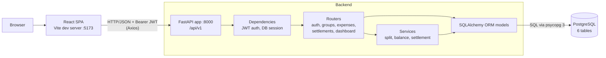
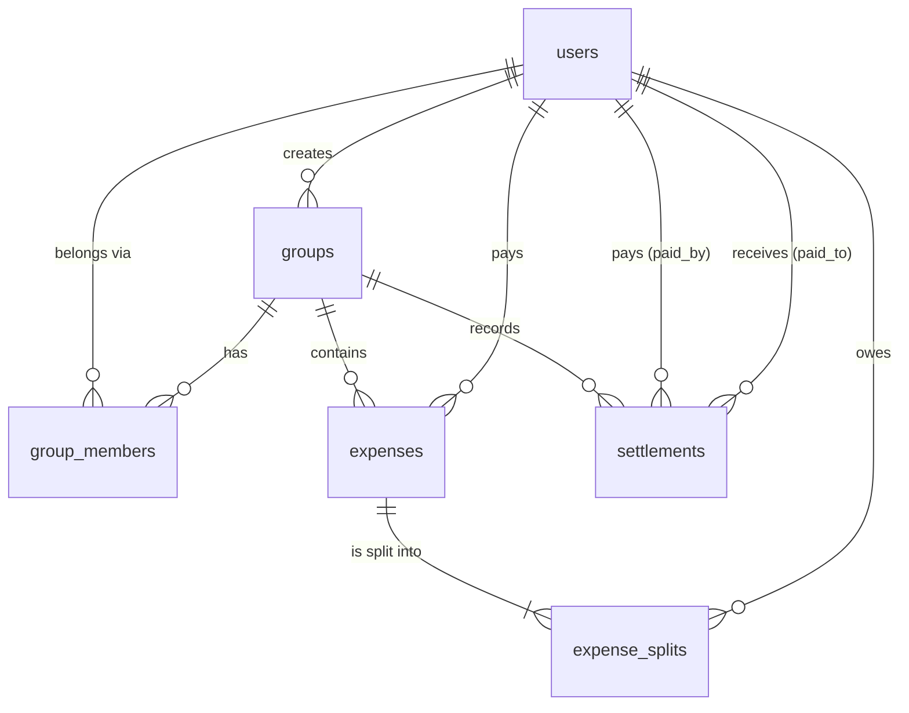
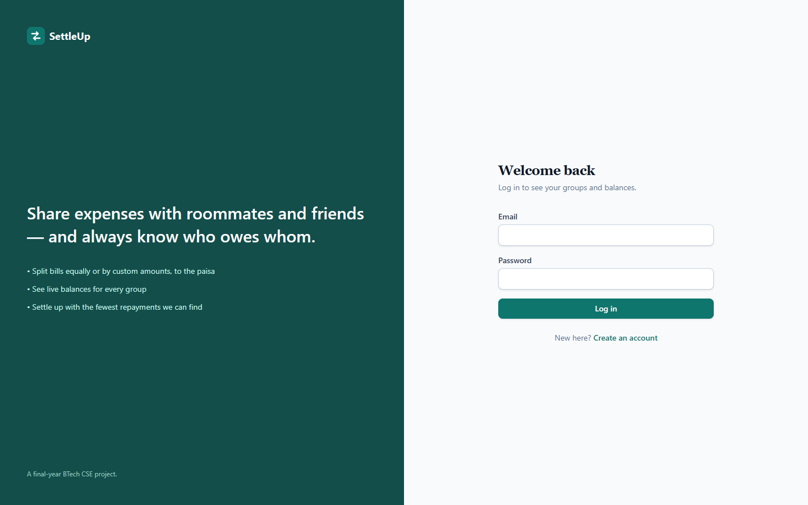
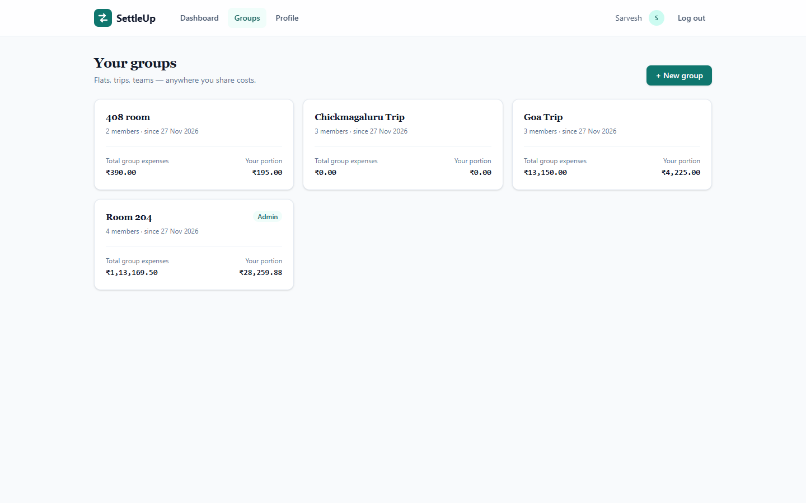
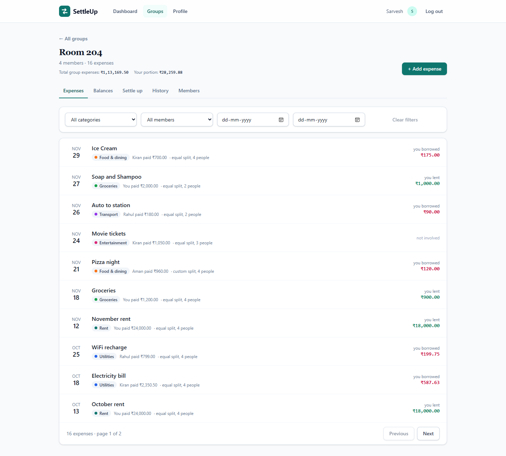
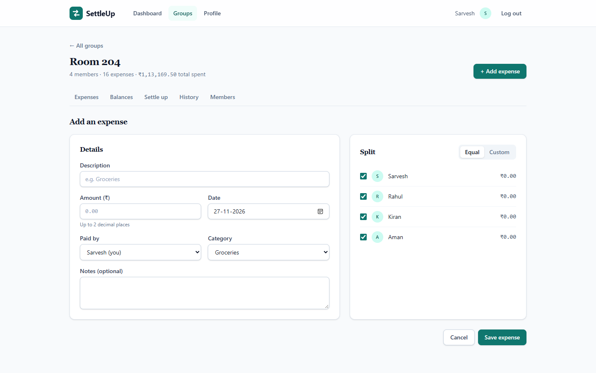
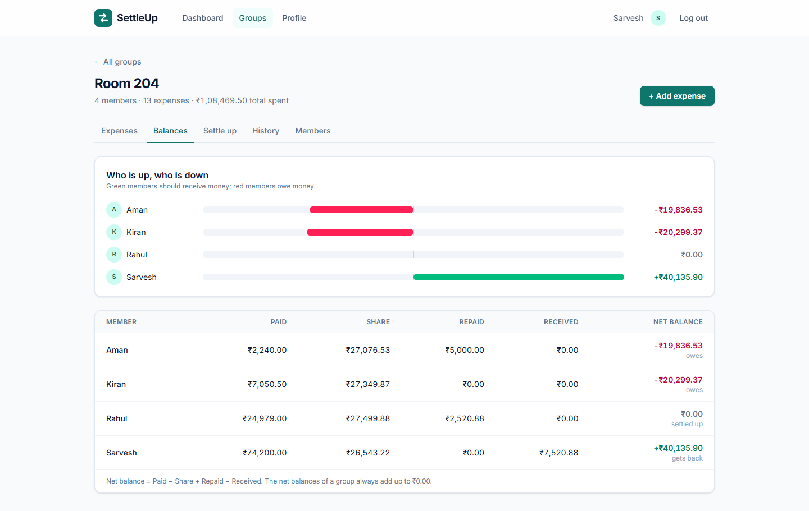
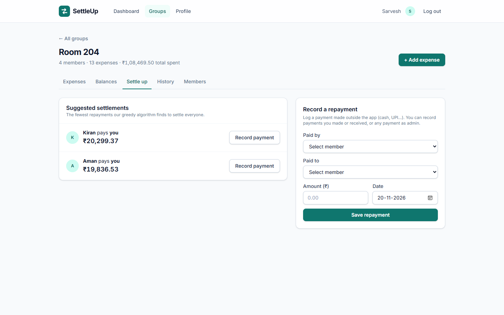

# SettleUp — Group Expense Management and Settlement Platform

SettleUp is a full-stack web application for roommates, friends and small groups who share
expenses. One person pays a bill, the app records who shares it, keeps a live balance for every
member, and suggests the fewest repayments it can find to settle everyone up.

It is our final-year BTech Computer Science team project, built with **React + FastAPI +
PostgreSQL**.


---

## Features

| Area | What is implemented |
|---|---|
| Accounts | Register, log in (JWT), "who am I" endpoint, profile page, logout (token cleared on the client) |
| Groups | Create groups, list *your* groups, group details, add registered users by email (admins only), list members, remove a member / leave a group, admin and member roles |
| Expenses | Create, view, edit, delete; equal split (paise-exact) or custom split; categories, dates and notes; filter by category, member and date range; pagination |
| Balances | Net balance per member computed from stored expenses, splits and settlements (`paid − share + repaid − received`) |
| Settling up | Greedy settlement suggestions; record repayments with validation inside a locked database transaction; settlement history |
| Dashboard | Total group spending, what you paid, your net balance, group count, monthly spending chart, category chart, recent expenses, settlements that involve you |

All money is stored and calculated as **integer paise** (₹125.50 → `12550`), never as floats.

## Technology stack

| Layer | Technologies |
|---|---|
| Frontend | React 19, JavaScript, Vite 6, Tailwind CSS 4, React Router 7, Axios, Recharts |
| Backend | Python 3.11+, FastAPI, Pydantic 2, SQLAlchemy 2, Alembic, PyJWT, bcrypt |
| Database | PostgreSQL 16 |
| Testing | Pytest (backend, against a real PostgreSQL test database), Vitest + Testing Library (frontend) |

Exact versions are pinned in [`backend/requirements.txt`](backend/requirements.txt) and
[`frontend/package.json`](frontend/package.json).

## Architecture



## Database (ER diagram)



Full schema, constraints and indexes: [`docs/schema.sql`](docs/schema.sql) and Chapter 8 of the
technical guide.

---

## Getting started (Windows PowerShell)

### 1. Prerequisites

* Python 3.11 or newer, Node.js 20 or newer, Git
* PostgreSQL 16 — either installed locally **or** via Docker (`docker compose up -d` from the
  repository root starts PostgreSQL on port 5432 with both databases created).

If you installed PostgreSQL yourself, create the two databases once:

```powershell
psql -U postgres -c "CREATE DATABASE settleup;" -c "CREATE DATABASE settleup_test;"
```

### 2. Backend

```powershell
cd backend
python -m venv .venv
.\.venv\Scripts\Activate.ps1
pip install -r requirements.txt
Copy-Item .env.example .env      # then edit DATABASE_URL / JWT_SECRET_KEY if needed
alembic upgrade head             # creates the 6 tables
python -m scripts.seed           # optional: sample roommates, groups and expenses
uvicorn app.main:app --reload    # http://localhost:8000
```

* Swagger UI: <http://localhost:8000/docs> — call `POST /api/v1/auth/login`, copy the
  `access_token`, click **Authorize** and paste it.
* Seeded accounts (development only): `sarvesh@example.com`, `rahul@example.com`,
  `kiran@example.com`, `aman@example.com` — password `Password@123`.

> **Windows tip:** if `pip install` or imports fail with *"The filename or extension is too
> long"*, clone the project into a short path such as `C:\dev\settleup`.

### 3. Frontend

```powershell
cd frontend
npm install
Copy-Item .env.example .env      # VITE_API_BASE_URL=http://localhost:8000/api/v1
npm run dev                      # http://localhost:5173
```

### 4. Tests

Backend (from the `backend` folder, with the virtual environment active):

```powershell
pytest -v                        # needs TEST_DATABASE_URL (wiped and rebuilt by the tests)
```

Frontend (from the `frontend` folder):

```powershell
npm test
```

Latest recorded runs: **97 backend tests passed** and **13 frontend tests passed** — see
[`docs/TEST_REPORT.md`](docs/TEST_REPORT.md) and the raw logs in
[`docs/test-results/`](docs/test-results/).

---

## API overview

All endpoints are under `/api/v1`; everything except register/login/health needs
`Authorization: Bearer <token>`.

| Method | Path | Purpose |
|---|---|---|
| POST | `/auth/register` | Create an account |
| POST | `/auth/login` | Get a JWT |
| GET | `/auth/me` | Current user |
| POST / GET | `/groups` | Create a group / list my groups |
| GET | `/groups/{group_id}` | Group details with members and totals |
| POST / GET | `/groups/{group_id}/members` | Add a member by email (admin) / list members |
| DELETE | `/groups/{group_id}/members/{user_id}` | Remove a member or leave |
| POST / GET | `/groups/{group_id}/expenses` | Create an expense / filtered, paginated history |
| GET / PATCH / DELETE | `/expenses/{expense_id}` | View / edit / delete an expense |
| GET | `/groups/{group_id}/balances` | Net balance of every member |
| GET | `/groups/{group_id}/settlements/suggested` | Greedy settlement plan |
| POST / GET | `/groups/{group_id}/settlements` | Record a repayment / history |
| GET | `/dashboard` | Personal dashboard data |
| GET | `/health` | Liveness check |

Every endpoint is documented in detail (request, response, validation, SQL, errors, curl
example) in Chapter 17 of the technical guide.

## Documentation

| File | Contents |
|---|---|
| [`docs/SettleUp_Complete_Technical_Guide.pdf`](docs/SettleUp_Complete_Technical_Guide.pdf) | Complete technical and interview-preparation guide (PDF) |
| [`docs/SettleUp_Complete_Technical_Guide.md`](docs/SettleUp_Complete_Technical_Guide.md) | Editable Markdown source of the guide |
| [`docs/TEST_REPORT.md`](docs/TEST_REPORT.md) | Test cases, expected vs actual results |
| [`docs/DEVELOPMENT_LOG.md`](docs/DEVELOPMENT_LOG.md) | What was built in which phase |
| [`docs/schema.sql`](docs/schema.sql) | SQL generated from the Alembic migration |
| [`docs/screenshots/`](docs/screenshots/) | Screenshots of every page (desktop and mobile) |

## Screenshots

| | |
|---|---|
|  |  |
|  |  |
|  |  |

## Project structure

```text
settleup/
├── backend/
│   ├── app/
│   │   ├── main.py            # FastAPI app, CORS, error handlers, routers
│   │   ├── config.py          # settings from environment / .env
│   │   ├── database.py        # engine, session factory, get_db dependency
│   │   ├── models/            # SQLAlchemy models (6 tables)
│   │   ├── schemas/           # Pydantic request/response models
│   │   ├── routers/           # API endpoints
│   │   ├── services/          # split, balance and settlement logic
│   │   ├── dependencies/      # authentication + group permission checks
│   │   └── utils/security.py  # bcrypt + JWT helpers
│   ├── alembic/               # migrations
│   ├── scripts/seed.py        # development seed data
│   └── tests/                 # pytest suite
├── frontend/
│   └── src/
│       ├── api/               # Axios client + one function per endpoint
│       ├── context/           # AuthContext (token + current user)
│       ├── components/        # layouts, ExpenseForm, UI building blocks
│       ├── pages/             # one file per screen (or group of screens)
│       ├── utils/             # money + formatting helpers
│       └── test/              # Vitest tests
├── docs/                      # guide (MD + PDF), test report, screenshots
└── docker-compose.yml         # optional local PostgreSQL
```

## Team

| Member | GitHub | Responsibility |
|---|---|---|
| Sarvesh | [sarvesh-s-g](https://github.com/sarvesh-s-g) | Database design and backend — PostgreSQL schema, ER diagram, constraints and indexes, SQLAlchemy models, Alembic migrations; FastAPI architecture, authentication, expense APIs, balance calculation, settlement algorithm, backend tests, technical guide |
| Sharanagouda | [sharanagoudabiradar](https://github.com/sharanagoudabiradar) | Frontend — React app, authentication screens, groups and members, expense forms, dashboard and charts, balance and settlement screens, API integration |
| Gollal | [MsGOLLAL](https://github.com/MsGOLLAL) | Frontend and backend support — frontend test suite (Vitest), development seed data, Docker PostgreSQL setup, dashboard API tests |

The frontend and backend meet only at the REST API (`/api/v1`), so both sides could be
developed in parallel.

## Branch strategy

* `main` — stable branch; work is merged into it from the branches below
* `backend/*` — backend work (e.g. `backend/core-api`)
* `frontend/*` — frontend work (e.g. `frontend/react-ui`)
* `feature/*` — work that touches both sides or the documentation

## Limitations

* Settlements are *records* of payments made outside the app; there is no UPI or bank
  integration.
* Members can only be added if they already have an account (no email invitations).
* JWTs are stateless and kept in `localStorage`; there is no refresh token or server-side
  revocation, so logout only removes the token from the browser.
* The greedy settlement plan uses at most *n − 1* payments but is not always the global
  minimum (a counter-example is in the test suite).
* Balances are recomputed with aggregate queries on every request — fine for student-scale
  groups, not tuned for very large data.
* Not deployed to production and not security-audited. See Chapter 23 of the guide.

## License

Academic project, for educational use.
