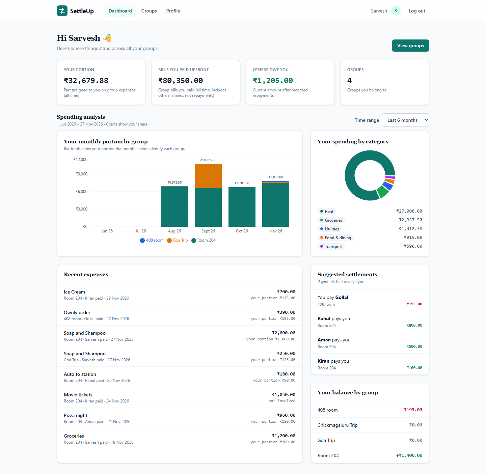

# SettleUp

SettleUp is a group expense tracker project. It helps groups keep track of shared expenses and see who owes whom.



## What it does

- Create groups and invite members.
- Add expenses and split them equally or enter custom shares.
- See group balances and suggested settlements.
- Record settlements made outside the app.
- View recent expenses and spending charts on the dashboard.

Money is stored as integer paise, so calculations don't rely on floating-point amounts.

## Built with

- **Frontend:** React, Vite, Tailwind CSS, React Router, Axios, Recharts
- **Backend:** Python, FastAPI, SQLAlchemy, Alembic
- **Database:** PostgreSQL
- **Authentication:** JWT

## Run it locally (Windows)

You'll need Python 3.11 or newer, Node.js 20 or newer, and PostgreSQL 16. You can run
PostgreSQL with Docker Desktop instead of installing it separately.

### 1. Start PostgreSQL

From the project folder:

```powershell
docker compose up -d
```

The compose file creates the `settleup` database and a separate `settleup_test` database.
If you use your own PostgreSQL installation, create both databases before continuing.

### 2. Set up and start the backend

In PowerShell:

```powershell
Set-Location backend
python -m venv .venv
.\.venv\Scripts\Activate.ps1
python -m pip install -r requirements.txt
Copy-Item .env.example .env
```

Check the values in `backend/.env`, then create the database tables and start the API:

```powershell
alembic upgrade head
python -m scripts.seed   # Optional: add sample data
uvicorn app.main:app --reload
```

The API runs at `http://localhost:8000`. Its interactive docs are at
`http://localhost:8000/docs`.

### 3. Start the frontend

Open another PowerShell window:

```powershell
Set-Location frontend
npm install
Copy-Item .env.example .env
npm run dev
```

Open `http://localhost:5173`. The frontend `.env` points to the local API by default.

## Tests

Run backend tests from the `backend` folder with its virtual environment activated:

```powershell
pytest
```

**Important:** the backend test setup clears and rebuilds the database configured by
`TEST_DATABASE_URL`. Keep it pointed at the separate `settleup_test` database, never your
development or production database.

Run frontend tests from the `frontend` folder:

```powershell
npm test
```

## Project folders

```text
backend/    FastAPI app, database models, migrations, and tests
frontend/   React app and frontend tests
docs/       Screenshots and database reference files
```

This project is not connected to a payment provider. Settlements are records of payments
made outside the app. For deployment, configure `VITE_API_BASE_URL` for the frontend and
`DATABASE_URL`, `JWT_SECRET_KEY`, and `CORS_ORIGINS` for the backend. Example environment
files are provided in `frontend/` and `backend/`.
